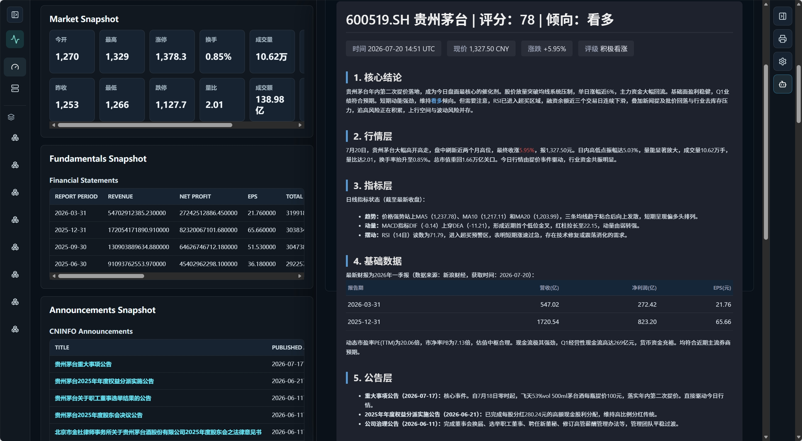

# A-Share Local Data Workbench

本项目是一个本地化 A 股研究数据工作台，用于读取本机 `free-stockdb` 数据、缓存公开研究数据、查看 K 线与多模块快照，并通过 AI 辅助生成结构化研究报告。

This project is a local A-share research workbench for cache-backed market inspection, module-level data review, and AI-assisted research reports. It is not a trading system and does not place orders, read broker accounts, or provide unconditional trading instructions.

## Screenshots / 界面截图

### Security View


### AI Analysis Sidebar



## Features / 核心功能

- **Security View**: local K-line chart, indicators, quote snapshot, market snapshot, and module snapshots.
- **Eight research modules**: Market, Fundamentals, Announcements, News, Research Reports, Chip/Liquidity, Signals, and ETF Options.
- **Cache-first workflow**: reads DuckDB cache first, then refreshes external/local sources in the background.
- **Source visibility**: module pages show explicit source status, freshness, failures, and optional dependency states.
- **AI Analyst**: right sidebar workflow for current page, full security, single module, or all-module analysis.
- **Dark financial UI**: dense, local-only research interface designed for repeated inspection.

## Architecture / 架构

- **Frontend**: React + Vite + TypeScript
- **Backend**: FastAPI
- **Database**: DuckDB
- **Local market data dependency**: `hello245m/free-stockdb`
- **Connector reference**: selected read-only source ideas from `simonlin1212/a-stock-data`

The application is designed as a local research tool. External public endpoints can throttle, drift, or fail, so every displayed source should be treated as research infrastructure rather than guaranteed real-time data.

## Requirements / 环境要求

- Windows local development environment
- Python 3.11+
- Node.js and npm
- `uv` for Python dependency management
- Local `free-stockdb` installation with downloaded market data
- `stockdb.exe` running on `127.0.0.1:7899`
- `stock_sdk.py` and `zhibiao.py` available through `ASHARE_FREE_STOCKDB_SDK_PATH`

## Quick Start / 快速启动

Install backend dependencies:

```powershell
cd backend
uv sync
cd ..
```

Install frontend dependencies:

```powershell
cd frontend
npm install
cd ..
```

Set the local free-stockdb SDK path. Replace the path with your own `pybao` directory:

```powershell
$env:ASHARE_FREE_STOCKDB_SDK_PATH = "D:\Edge\free-stockdb-main\pybao"
```

Start the workbench:

```powershell
.\start_workbench.cmd
```

The app opens at:

```text
http://127.0.0.1:5173
```

Check dependencies without starting servers:

```powershell
.\start_workbench.cmd -CheckOnly
```

Start with labeled demo rows:

```powershell
.\start_workbench.cmd -DemoData
```

Demo rows are labeled as fixtures and should not be treated as current market data.

## free-stockdb Setup / 本地数据库与 SDK

This repository does **not** include `free-stockdb`, the Python SDK files, `stockdb.exe`, or any local market database.

其他用户从 GitHub 下载本项目后，不能只靠本仓库直接运行完整行情和指标功能。他们还需要自行完成：

1. Install or clone [`hello245m/free-stockdb`](https://github.com/hello245m/free-stockdb).
2. Download and maintain local A-share data through free-stockdb.
3. Start `stockdb.exe` and confirm it serves `127.0.0.1:7899`.
4. Set `ASHARE_FREE_STOCKDB_SDK_PATH` to the `pybao` folder that contains `stock_sdk.py` and `zhibiao.py`.
5. Run this project's backend and frontend dependencies.

The backend bootstrap checks `ASHARE_FREE_STOCKDB_SDK_PATH` first. If it is not set, the current Windows default is:

```text
D:\Edge\free-stockdb-main\pybao
```

This default is only a local convenience path. Other machines should configure their own path.

## AI Analyst / AI 分析

The right sidebar supports OpenAI, Anthropic Claude, and DeepSeek API-compatible analysis. API keys are entered in the UI for the current session and are sent only for the single backend request. Keys are not stored in DuckDB, logs, source health, jobs, `MEMORY.md`, or browser local storage.

AI analysis can use structured page/module/security data first and a workspace screenshot only when the selected model supports image input. Reports follow `AIReport.md` and are intended for research support, not trade execution.

## API Overview / API 概览

- `GET /api/health`
- `GET /api/modules`
- `GET /api/connectors/capabilities`
- `GET /api/securities/search`
- `GET /api/security/{symbol}/overview`
- `POST /api/security/{symbol}/refresh`
- `GET /api/security/{symbol}/quote`
- `GET /api/security/{symbol}/chart`
- `GET /api/modules/{module}/data`
- `POST /api/modules/{module}/refresh`
- `POST /api/ai/check`
- `POST /api/ai/analyze`
- `GET /api/jobs`
- `GET /api/data-sources/status`

## Data Safety / 数据安全

- `trade_date` and `fetched_at` are separate fields.
- Missing, stale, failed, and not collected states are explicit.
- Demo data is labeled as `local_fixture`.
- Public web sources may throttle, drift, or fail.
- This project must not store secrets, API keys, broker credentials, account information, or local database files in Git.
- This project does not place, cancel, or route live orders.

## Acknowledgements / 致谢

本项目在以下开源项目基础上进行本地研究工作台搭建，并参考了其中的数据、SDK 或连接器设计思路：

- [`hello245m/free-stockdb`](https://github.com/hello245m/free-stockdb)
- [`simonlin1212/a-stock-data`](https://github.com/simonlin1212/a-stock-data)

感谢上述项目作者的开源工作。如有冒犯、引用不当或许可证理解不当，请告知，我会第一时间调整或删除本项目。

## 许可证与免责声明

本仓库适用 [项目许可证](https://github.com/hello245m/free-stockdb/blob/main/LICENSE)。数据版权、使用授权和再分发条件由各数据源及其权利人决定；使用者应自行确认数据源条款。

本项目用于软件学习、数据管理与量化研究，不构成投资建议。任何数据完整性、及时性和交易决策风险均应由使用者独立评估。
